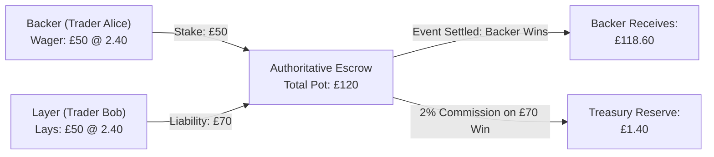
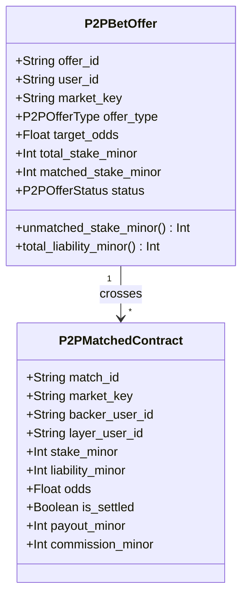

# RFC 011: Peer-to-Peer (P2P) Betting Exchange & Escrow Matching Architecture

**Status:** Standard / Active  
**Author:** Architecture Core Team  
**Date:** 2026-10-26  
**Supercedes:** None  
**Related Specifications:** [RFC 002: Financial Ledger Immutability](002-financial-ledger-immutability.md), [RFC 009: Anti-Fraud & Latency Arbitrage](009-anti-fraud-latency-arbitrage.md)

---

## 1. Executive Summary

Traditional sportsbook wagering pits individual players against a bookmaker holding a structural margin (overround typically between 4% and 8%). RFC 011 specifies the architecture for the **Peer-to-Peer (P2P) Betting Exchange**, allowing market participants to trade directly with one another at true market prices.

Traders can either **Back** (bet that an event will happen) or **Lay** (bet that an event will not happen, acting as the counterparty). The platform operates strictly as a neutral matching venue and escrow custodian, monetizing through a flat 2.0% fee assessed solely on net winning trades upon event settlement.

---

## 2. Mathematical Escrow & Collateral Requirements

In any peer-matched wager with nominal stake $S$ (in integer minor units) and decimal odds $O$:

### 2.1 Backer Collateral
The Backer's risk is strictly bounded by their staked principal:
$$E_{\text{backer}} = S$$

The Backer's gross return upon winning is:
$$R_{\text{backer}} = S \cdot O$$
The Backer's net profit is:
$$P_{\text{backer}} = S \cdot (O - 1)$$

### 2.2 Layer Collateral (Liability)
The Layer acts as the counterparty (bookmaker). If the outcome occurs, the Layer must pay the Backer's net winnings. Consequently, the Layer must post collateral equal to the full liability upfront:
$$E_{\text{layer}} = \lceil S \cdot (O - 1) \rceil$$

If the outcome does not occur, the Layer keeps the Backer's stake $S$ as gross winnings.

### 2.3 Total Escrow Conservation
At the moment of match execution, both parties' collateral is atomically transferred from `USER_BALANCE` to `ESCROW_HELD`:
$$E_{\text{total}} = E_{\text{backer}} + E_{\text{layer}} = S + \lceil S \cdot (O - 1) \rceil = S \cdot O$$

Zero counterparty default risk is guaranteed because the escrow account holds exactly 100% of maximum potential payout before kickoff.

---

## 3. Order Book Matching Engine

The exchange maintains an independent central limit order book (CLOB) for each market selection.

### 3.1 Price-Time Priority
Orders are executed with strict Price-Time priority:
1. **Back Takers:** Match against resting Lay makers with the highest available odds ($O_{\text{maker}} \ge O_{\text{taker}}$). If multiple makers offer the same odds, earlier timestamp takes precedence.
2. **Lay Takers:** Match against resting Back makers with the lowest available odds ($O_{\text{maker}} \le O_{\text{taker}}$).
3. **Execution Price:** Trades execute at the **maker's posted odds**, providing price improvement to the aggressing taker.

### 3.2 Partial Fills & Cancellations
- When an order matches a counterparty with a smaller available volume, the order transitions to `PARTIALLY_MATCHED`.
- The remaining unmatched stake remains in the book as a resting maker order.
- Traders may cancel the unmatched portion of an open order at any time prior to match commencement. The corresponding escrow collateral is instantly refunded to their available balance.

---

## 4. Commission Model & Double-Entry Settlement

The exchange assesses zero deposit fees, zero withdrawal fees, and zero listing fees. Revenue is earned exclusively via a post-settlement commission on net profitable contracts:

$$\text{Commission} = \begin{cases} 
\lfloor P_{\text{net}} \times 0.02 \rfloor & \text{if } P_{\text{net}} > 0 \\ 
0 & \text{if } P_{\text{net}} \le 0 
\end{cases}$$

### 4.1 Settlement Ledger Invariants
When an event concludes, the authoritative settlement pipeline journalizes the transaction across ledger accounts:

| Step | Debit Account | Credit Account | Amount | Purpose |
| :--- | :--- | :--- | :--- | :--- |
| **1** | `ESCROW_HELD` | `USER_BALANCE` | $E_{\text{total}} - \text{Commission}$ | Winning trader net payout |
| **2** | `ESCROW_HELD` | `HOUSE_RESERVE` | $\text{Commission}$ | Exchange trading fee |

Losing traders require zero debit operations at settlement because their collateral was already deducted into escrow at order match time.

---

## 5. Integrity & Market Manipulation Protections

1. **Self-Cross Prevention:** An automated wash-trading prevention filter rejects any incoming taker order that would match against an open maker offer originating from the same `user_id` or linked payment identity.
2. **Pre-Match In-Play Cutoff:** All resting unmatched orders are cancelled automatically at the kickoff whistle ($t_0$) to prevent stale price sniping. In-play exchange markets require a mandatory 3,000ms delay countdown for every submitted offer.
3. **Integer Minor Conservation:** All internal matching calculations operate strictly in integer minor units (pennies/cents), with fractional rounding remainder allocated to the escrow reserve to eliminate precision leakage.
