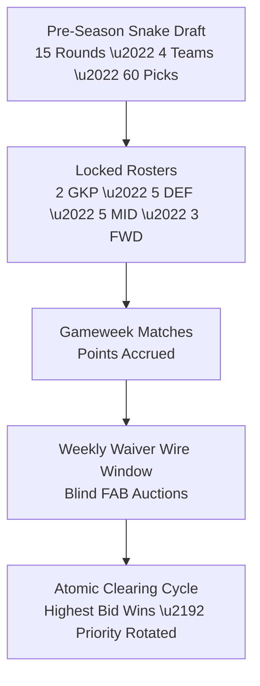
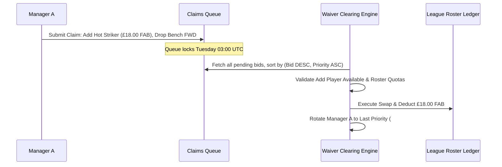

# RFC 012: Fantasy Football Snake Draft & Free Agency Budget (FAB) Specification

**Status:** Standard / Active  
**Author:** Fantasy League Operations & Quantitative Modeling  
**Date:** 2026-10-26  
**Supercedes:** None  
**Related Specifications:** [RFC 004: Fantasy Football Scoring Engine](004-fantasy-football-scoring-and-transfer-market.md)

---

## 1. Executive Summary

Competitive fantasy football seasons begin with an inaugural multi-team draft followed by weekly post-matchday player acquisitions. RFC 012 formalizes the mathematical specifications for:
1. **The 15-Round Snake Draft Rotation:** Balancing draft slot advantage across $N$ competing league managers.
2. **Algorithmic Auto-Pick & VORP Metric:** Automated selection fallback optimizing Value-Over-Replacement Player.
3. **Blind-Auction Free Agent Acquisition Budget (FAB):** Secret auction clearing mechanism for weekly waiver wire claims with rolling priority tie-breaking.

---

## 2. Serpentine (Snake) Draft Rotation Formulation

Let $N$ denote the total number of teams in the league ($N \ge 2$). The draft spans exactly 15 rounds ($R \in \{1, 2, \dots, 15\}$), yielding a total of $15 \cdot N$ player selections.

The team allocated draft pick $k \in \{1, 2, \dots, N\}$ in round $R$ is defined by the piecewise reflection mapping:

$$\text{TeamIndex}(R, k) = \begin{cases} 
k & \text{if } R \equiv 1 \pmod 2 \quad (\text{Odd Rounds: } 1 \to N) \\ 
N - k + 1 & \text{if } R \equiv 0 \pmod 2 \quad (\text{Even Rounds: } N \to 1) 
\end{cases}$$

The global overall pick index $O(R, k) \in \{1, 2, \dots, 15 \cdot N\}$ is:
$$O(R, k) = (R - 1) \cdot N + k$$

This ensures that the manager receiving the 1st overall pick in Round 1 receives the last pick in Round 2 ($2N$), minimizing draft position variance.

---

## 3. Value-Over-Replacement Player (VORP) Metric

When an automated turn clock expires without human input, the draft engine invokes an algorithmic auto-pick. Rather than selecting purely by total projected fantasy points, the auto-pick engine utilizes **Value-Over-Replacement Player (VORP)**.

$$\text{VORP}(i) = \text{ProjectedPoints}(i) - \text{ReplacementLevel}(\text{Position}(i))$$

Where $\text{ReplacementLevel}(\text{pos})$ is the projected output of the highest-ranked unowned player available at that position once all starting slots are filled:

| Position | Total League Roster Slots ($N = 10$) | Replacement Baseline Rank |
| :--- | :--- | :--- |
| **Goalkeeper (GKP)** | 20 ($2 \times 10$) | Rank 21 GKP |
| **Defender (DEF)** | 50 ($5 \times 10$) | Rank 51 DEF |
| **Midfielder (MID)** | 50 ($5 \times 10$) | Rank 51 MID |
| **Forward (FWD)** | 30 ($3 \times 10$) | Rank 31 FWD |

An elite midfielder projected for 220 points against a 110-point replacement baseline ($\text{VORP} = +110$) is prioritized over an elite goalkeeper projected for 160 points against a 130-point baseline ($\text{VORP} = +30$).

---

## 4. Free Agent Acquisition Budget (FAB) Clearing Cycle

Post-draft free agents reside on the **Waiver Wire**. Between gameweeks, managers submit confidential blind bids from their seasonal allocation of 10,000 minor units (£100.00 FAB).

### 4.1 Resolution Algorithm
1. Claims are sorted in descending order of blind bid amount: $\text{BidAmount}_{\text{minor}}$.
2. **Tie-Breaking:** If two or more managers submit identical FAB bids for the same target player, the manager with the lower **Waiver Priority Rank** ($1$ being highest) wins the player.
3. **Escrow & Balance Verification:** If the winning claim exceeds the manager's available FAB balance, the claim is rejected with `FAILED_INSUFFICIENT_FUNDS`.
4. **Waiver Priority Rotation:** Upon successfully claiming a player, the winning manager's priority rank is reset to $N$ (last position). All managers previously ranked below the winner advance by $1$ rank position.
