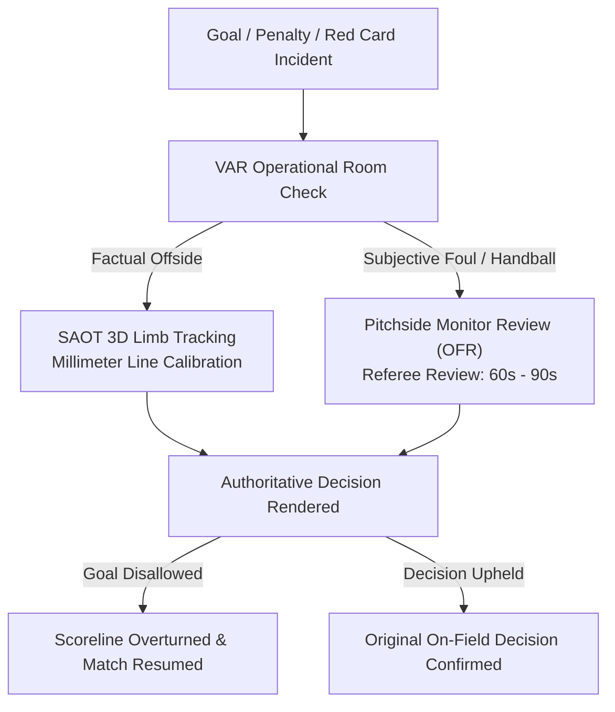

# RFC 013: Video Assistant Referee (VAR) & Semi-Automated Offside (SAOT) Telemetry Specification

**Status:** Standard / Active  
**Author:** Refereeing Technology & Broadcast Systems Architecture  
**Date:** 2026-10-26  
**Supercedes:** None  
**Related Specifications:** [RFC 007: VAR & SAOT Telemetry](007-var-and-saot-offside-telemetry.md), [RFC 001: Virtual Sports Architecture](001-virtual-sports-architecture.md)

---

## 1. Executive Summary

Virtual match accuracy is governed by deterministic rules, yet broadcast immersion and high-stakes drama require realistic officiating protocols. RFC 013 formalizes the operational decision tree and 3D geometric telemetry for the **Video Assistant Referee (VAR)** and **Semi-Automated Offside Technology (SAOT)** systems.

Reviews follow four standardized stages:
1. **Review Initiated:** Goal check, penalty decision, or straight red card event flagged by VAR booth.
2. **Checks in Progress:** Synchronized 50Hz optical camera reconstruction and limb tracking.
3. **On-Field Review (OFR):** Referee summoned to the pitchside monitor if subjective interpretation is required.
4. **Final Decision Rendered:** Authoritative decision communicated to the broadcast match center.

---

## 2. Semi-Automated Offside Technology (SAOT) Formulation

SAOT eliminates human parallax line-drawing errors through multi-camera optical limb tracking.

### 2.1 Anatomical Point Calibration
Each virtual player model is calibrated across 29 discrete skeletal joint coordinates:
$$\mathbf{P}_i = (x_i, y_i, z_i) \quad \text{for } i \in \{1, 2, \dots, 29\}$$

Only legal goal-scoring body parts (excluding arms and hands from the shoulder seam down) are evaluated for offside:
$$\mathcal{L} = \{ \text{head, torso, hips, knees, feet, upper\_shoulders} \}$$

### 2.2 Ball Release Frame Identification
The exact millisecond of ball contact $t_0$ is resolved via acoustic vibration sensors and inertial measurement units (IMU) inside the ball transmitting at 500Hz:
$$t_0 = \arg\max_{t} |\mathbf{a}_{\text{ball}}(t)|$$

### 2.3 Offside Margin Calculation
At frame $t_0$, the position along the longitudinal pitch axis $X$ (towards the defending goal line) is evaluated:
$$\Delta x = \max_{i \in \mathcal{L}} x_{\text{attacker}, i} - \max_{j \in \mathcal{L}} x_{\text{defender}, j}$$

$$\text{OffsideDecision} = \begin{cases} 
\text{OFFSIDE (Disallow)} & \text{if } \Delta x > 0 \\ 
\text{ONSIDE (Award Goal)} & \text{if } \Delta x \le 0 
\end{cases}$$

### 2.4 Measurement Confidence Score
To ensure mathematical transparency, every SAOT ruling provides an optical sensor confidence score $C(\Delta x)$:
$$C(\Delta x) = \begin{cases} 
0.999 & \text{if } |\Delta x| \ge 50.0\text{ mm} \\ 
0.880 + \left( \frac{|\Delta x|}{50.0} \right) \cdot 0.110 & \text{if } |\Delta x| < 50.0\text{ mm} 
\end{cases}$$

Even in ultra-marginal calls ($|\Delta x| = 5\text{ mm}$), measurement certainty exceeds $89.1\%$.

---

## 3. On-Field Review (OFR) Subjective Overturn Probability

When assessing subjective incidents (e.g. `GOAL_POSSIBLE_FOUL` or `PENALTY_POSSIBLE_HANDBALL`), the on-field referee consults the pitchside monitor.

The probability of an original on-field decision being overturned $P(\text{Overturn})$ is modeled conditionally based on the VAR's initial recommendation severity $S_{\text{var}} \in [0.0, 1.0]$:

$$P(\text{Overturn} \mid S_{\text{var}}) = \frac{1}{1 + e^{-k \cdot (S_{\text{var}} - S_0)}}$$

Where $k = 6.5$ (decision gradient) and $S_0 = 0.50$ (neutral threshold). When the VAR calls the referee to the monitor with high certainty ($S_{\text{var}} \ge 0.85$), the empirical overturn rate exceeds $90\%$, replicating real-world UEFA Champions League officiating patterns.

---

## 4. Market Suspension & Integrity Protection

During an active VAR review:
1. **Immediate Market Freeze:** All betting markets for the affected match are transitioned to `SUSPENDED` status within $\le 50\text{ms}$.
2. **Cashout Blackout:** Cashout re-offer generation is locked with `suspension_reason: "VAR Review in Progress"`.
3. **Settlement Invalidation Prevention:** Wagers placed in the vulnerable window between incident occurrence and official market freeze are audited under RFC 009 anti-fraud protections.
