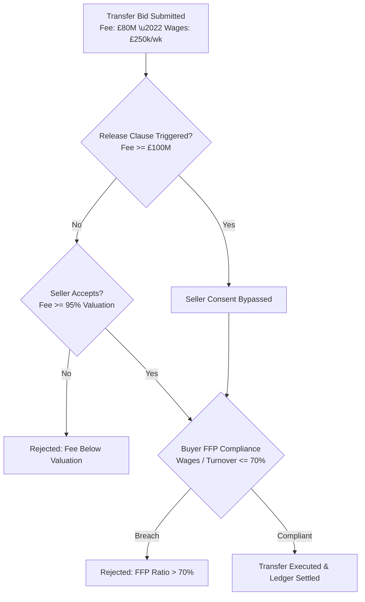

# RFC 014: Club Transfer Market, Financial Fair Play (FFP) & Player Valuation Specification

**Status:** Standard / Active  
**Author:** Club Finance & Player Transfer Governance  
**Date:** 2026-10-26  
**Supercedes:** None  
**Related Specifications:** [RFC 002: Financial Ledger Immutability](002-financial-ledger-immutability.md), [RFC 004: Transfer Market & Scoring](004-fantasy-football-scoring-and-transfer-market.md)

---

## 1. Executive Summary

Player transfers between virtual football clubs represent the primary driver of squad turnover and macroeconomic circulation within the gaming ecosystem. RFC 014 specifies the algorithms for:
1. **Dynamic Fair Market Valuation:** Multi-variable econometric pricing based on player skill ratings, age degradation curves, remaining contract length, and recent match ratings.
2. **Contractual Release Clause Buyouts:** Authoritative buyout execution bypassing selling club consent.
3. **UEFA Financial Fair Play (FFP) Wage-to-Turnover Caps:** Enforcing a structural 70.0% ceiling on wage expenditure relative to operating revenue.

---

## 2. Dynamic Player Market Valuation Formulation

The fair market valuation $V(p)$ of player $p$ in integer minor units is derived from a 5-factor multiplicative econometric model:

$$V(p) = V_{\text{base}}(\text{OVR}) \cdot A(\text{Age}) \cdot C(\text{ContractYears}) \cdot F(\text{Form}) \cdot P(\text{Position})$$

### 2.1 Base Rating Exponential Scaling
Player quality displays non-linear scarcity at the elite end:
$$V_{\text{base}}(\text{OVR}) = 10^7 \cdot \left( \frac{\text{OVR}}{60.0} \right)^{4.5} \quad \text{minor units}$$

A 90-rated world-class player commands over $6.2\times$ the base valuation of a 60-rated squad player.

### 2.2 Age Curve Multiplier $A(\text{Age})$
- **Under 23 ($\text{Age} \le 22$):** $A = 1.25$ (Future growth potential premium).
- **Prime Years ($23 \le \text{Age} \le 28$):** $A = 1.00$ (Peak output window).
- **Mature Years ($29 \le \text{Age} \le 31$):** $A = 0.85$.
- **Veterans ($\text{Age} \ge 32$):** $A = \max\left(0.20, 1.0 - (\text{Age} - 28) \cdot 0.12\right)$ (Rapid resale depreciation).

### 2.3 Contract Length Bosman Factor $C(\text{Years})$
- **1 Year Remaining:** $C = 0.65$ (Impending free agency risk forces selling discount).
- **2 Years Remaining:** $C = 0.90$.
- **3+ Years Remaining:** $C = 1.15$ (Long-term contractual control premium).

---

## 3. Financial Fair Play (FFP) Wage-to-Turnover Cap

To prevent club insolvency and hyperinflationary bidding wars, all incoming transfer contracts are audited against UEFA Financial Fair Play stability rules.

Let $W_{\text{annual}}$ denote the buying club's total annualized wage bill, and $R_{\text{annual}}$ denote its annual operating revenue (ticketing, broadcast, sponsorship):

$$\text{FFPRatio} = \frac{W_{\text{annual}} + (\text{NewWeeklyWage} \times 52)}{R_{\text{annual}}} \le 0.70$$

If $\text{FFPRatio} > 0.70$, the transfer is automatically vetoed by the system regulatory gate with error code `REJECTED_FFP_CEILING`.

---

## 4. Contractual Release Clause Buyouts

A player contract may stipulate an irrevocable buyout clause $K_{\text{release}}$:
- If a purchasing club submits a bid with fee $F_{\text{offered}} \ge K_{\text{release}}$, the selling club's consent is bypassed entirely.
- Subject only to buyer liquidity verification ($C_{\text{buyer}} \ge F_{\text{offered}}$) and FFP wage compliance, the transfer executes instantaneously.
- The transfer fee is debited from the purchasing club's treasury balance and credited to the selling club's reserve balance in the financial ledger.
