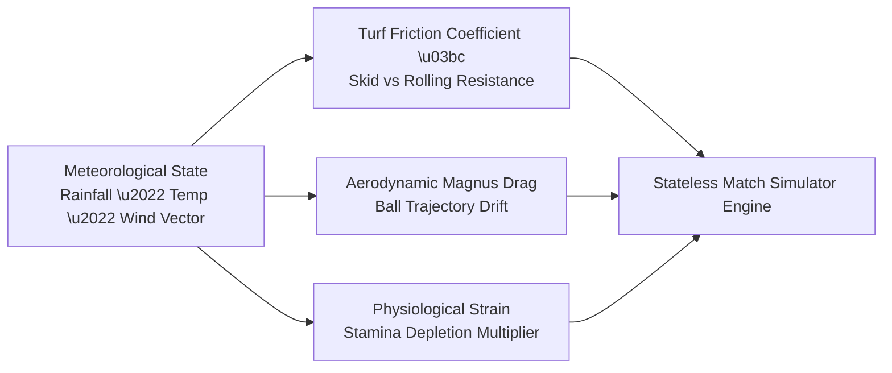

# RFC 015: Matchday Weather Physics, Turf Resistance & Aerodynamic Ball Dynamics

**Status:** Standard / Active  
**Author:** Simulation Physics & Environmental Modeling Working Group  
**Date:** 2026-10-26  
**Supercedes:** None  
**Related Specifications:** [RFC 008: Stadium Weather & Turf Physics](008-stadium-weather-and-turf-physics.md), [RFC 001: Virtual Sports Architecture](001-virtual-sports-architecture.md)

---

## 1. Executive Summary

Football is an outdoor discipline shaped by meteorological thermodynamics. In virtual sports simulations, naive static probabilities produce repetitive matches. RFC 015 specifies the formal environmental physics equations governing:
1. **Turf Kinetic Friction & Surface Moisture Dynamics:** How rain, snow, and irrigation modulate ball skid and rolling resistance.
2. **Aerodynamic Drag & Vector Wind Drift:** Modifying crossing trajectories and long-range shot paths.
3. **Player Thermal Fatigue & Stamina Degradation:** Temperature-dependent physiological strain.

---

## 2. Turf Moisture & Kinetic Friction Formulation

The interaction between the leather ball and the pitch surface is parameterized by the **Turf Friction Coefficient** $\mu \in [0.35, 0.95]$ and **Rebound Restitution** $e \in [0.50, 0.85]$.

### 2.1 Environmental Friction Coefficients

| Weather Condition | Turf Moisture (%) | Friction Coefficient $\mu$ | Rebound Elasticity $e$ | Ball Physical Behavior |
| :--- | :--- | :--- | :--- | :--- |
| **Pristine / Clear** | 20% | $\mu = 0.60$ | $e = 0.75$ | Baseline standard bounce & roll |
| **Heavy Rain / Slick** | 90% | $\mu = 0.42$ | $e = 0.65$ | Rapid ball skid; long passes accelerate; slippery GK handling |
| **Frozen / Snow** | 50% | $\mu = 0.88$ | $e = 0.52$ | High rolling resistance; short passes stall; high fatigue |
| **Heatwave / Dry** | 5% | $\mu = 0.72$ | $e = 0.82$ | High bounce height; erratic rebounds; player cramping |

### 2.2 Ball Skimming Equation
The deceleration of a ball skimming across wet turf with horizontal velocity $\mathbf{v}$ is governed by:
$$\frac{d\mathbf{v}}{dt} = -\mu(M_{\text{turf}}) \cdot g \cdot \hat{\mathbf{v}}$$

Where $g = 9.81\text{ m/s}^2$ and $M_{\text{turf}}$ is moisture percentage. On slick rain-soaked turf ($\mu = 0.42$), passing velocity decays $30\%$ slower than on dry turf, rewarding through-balls into space.

---

## 3. Aerodynamic Wind Drift Vector & Magnus Effect

Wind exerts an aerodynamic drag force $\mathbf{F}_{\text{drag}}$ on aerial crosses and shots:

$$\mathbf{F}_{\text{drag}} = \frac{1}{2} C_d \cdot \rho(T) \cdot A \cdot |\mathbf{v}_{\text{rel}}| \cdot \mathbf{v}_{\text{rel}}$$

Where:
- $\mathbf{v}_{\text{rel}} = \mathbf{v}_{\text{ball}} - \mathbf{w}$ (Relative velocity vector against wind vector $\mathbf{w} = (w_x, w_y)$).
- $\rho(T) = \frac{p}{R_{\text{spec}} \cdot T}$ (Air density varying with atmospheric temperature).
- $C_d \approx 0.25$ (Drag coefficient for a rotating football).
- $A = \pi r^2 \approx 0.038\text{ m}^2$ (Cross-sectional area of standard Size 5 ball).

In gusts exceeding $35\text{ km/h}$, corner kicks into the wind require higher initial launch speed, while long-range shots downwind experience knuckleball swerve.

---

## 4. Player Fatigue Multiplier Under Temperature Extremes

Player stamina $S(t) \in [0, 100]$ depletes dynamically during sprinting and pressing phases. Meteorological temperature $T_{\text{celsius}}$ scales the base depletion rate:

$$\frac{dS}{dt} = -\kappa_{\text{tactical}} \cdot \Psi_{\text{weather}}(T) \cdot I_{\text{press}}$$

$$\Psi_{\text{weather}}(T) = \begin{cases} 
1.00 & \text{if } 14^\circ\text{C} \le T \le 22^\circ\text{C} \quad (\text{Optimal}) \\ 
1.00 + (T - 22) \cdot 0.018 & \text{if } T > 22^\circ\text{C} \quad (\text{Thermal Dehydration}) \\ 
1.00 + (14 - T) \cdot 0.012 & \text{if } T < 14^\circ\text{C} \quad (\text{Cold Muscle Rigidity}) 
\end{cases}$$

Under heatwave conditions ($34^\circ\text{C}$), stamina depletes $21.6\%$ faster, accelerating late-game defensive lapses and increasing injury strain risks.
